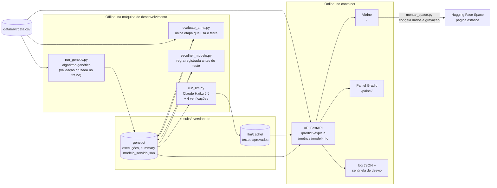

# Detecção de riscos em saúde da mulher

Classificação de tumores de mama (maligno vs. benigno) com Machine Learning — Tech Challenge das
Fases 1 e 2 da pós-graduação em Inteligência Artificial da FIAP.

A **Fase 2** acrescenta três camadas sobre a Fase 1, que segue congelada na tag `v1.0-fase1`:
otimização por **algoritmo genético** (medidas, hiperparâmetros e limiar, buscados juntos contra um
custo clínico assimétrico), **explicações em linguagem natural** geradas por modelo de linguagem e
verificadas automaticamente, e o sistema **servido** como API com monitoramento e painel. Como
executar cada parte está em [Fase 2](#fase-2).

**Painel publicado:** https://huggingface.co/spaces/gustavofks/apoio-diagnostico-cancer-mama

**Tudo o que a Fase 2 mudou:**
[comparação entre `v1.0-fase1` e o estado atual](https://github.com/gustavofks/ML-breast-cancer/compare/v1.0-fase1...main)

Uma rede de hospitais especializados no atendimento à mulher precisa de um sistema de apoio ao
diagnóstico capaz de acelerar a triagem. Este projeto entrega a base de Machine Learning dessa
solução: a partir de características morfológicas de núcleos celulares extraídas de punção
aspirativa por agulha fina (PAAF), o modelo classifica o tumor como **maligno** ou **benigno**.

> O modelo é uma ferramenta de triagem e segunda opinião. O diagnóstico final é sempre do médico.
> Essa premissa orienta todas as decisões técnicas do projeto — da escolha da métrica à exigência
> de explicabilidade.

## Resultados

Modelo escolhido: **Regressão Logística** (`C = 1,0`), vencedora sobre KNN e Random Forest na
validação cruzada estratificada de 5 folds.

| Métrica | Validação cruzada (treino) | Conjunto de teste |
|---|---|---|
| Acurácia | 0,974 | 0,965 |
| **Recall (maligno)** | **0,953** | **0,929** |
| F1 | 0,964 | 0,951 |
| AUC | 0,996 | 0,996 |

No conjunto de teste (114 casos): 71 verdadeiros negativos, 39 verdadeiros positivos, 1 falso
positivo e **3 falsos negativos**. Ajustando o limiar de decisão de 0,50 para 0,30, os falsos
negativos caem para 1 sem aumento de falsos positivos.

A métrica prioritária é o **recall da classe maligna**: um falso negativo significa um tumor
maligno classificado como benigno — o erro de maior custo clínico. A acurácia é reportada, mas não
decide: com 62,7% de casos benignos, um classificador trivial já a atingiria.

### Entrega extra — diagnóstico por imagem

Classificação de ultrassom mamário (BUSI, 780 imagens, 3 classes) partindo do pixel cru, sem
medidas extraídas por especialista:

| Modelo | Acurácia | F1 macro | Recall maligno | Malignos não detectados |
|---|---|---|---|---|
| **MobileNetV2 (ajuste fino)** | 0,839 | 0,821 | **0,900** | 3 de 30 |
| MobileNetV2 (transferência) | 0,759 | 0,751 | 0,767 | 7 de 30 |
| CNN do zero | 0,563 | 0,240 | 0,000 | 30 de 30 |

A CNN treinada do zero atinge 56,3% de acurácia **sem detectar um único caso maligno**: aprendeu a
responder "benigno", que é a resposta mais frequente. Com 556 imagens de treino, transferência de
aprendizado não é otimização — é o que torna a tarefa possível.

Duas decisões metodológicas sustentam esses números:

- **Partição por grupos.** A base tem 112 imagens que são quadros repetidos de exames já presentes,
  e 62 pares caíam em partições diferentes. Cada grupo de quadros quase idênticos agora cai inteiro
  em um único conjunto, eliminando o vazamento.
- **Execução determinística.** Sementes fixas no TensorFlow: duas execuções produzem exatamente as
  mesmas métricas.

A explicabilidade usa **Grad-CAM**, equivalente visual do SHAP: nos casos detectados o calor se
concentra sobre a lesão; nos que escapam, a lesão fica fria e a atenção migra para uma região
irrelevante da imagem.

## Base de dados

**Breast Cancer Wisconsin (Diagnostic)** — 569 amostras, 30 características numéricas, sem valores
ausentes. Distribuição: 357 benignos (62,7%) e 212 malignos (37,3%).

- Arquivo incluído no repositório: [`data/raw/data.csv`](data/raw/data.csv)
- Fonte original: https://www.kaggle.com/datasets/uciml/breast-cancer-wisconsin-data

## Como executar

Requer **Python 3.11**.

```bash
# 1. Ambiente virtual
py -3.11 -m venv .venv
.venv\Scripts\activate          # Windows
# source .venv/bin/activate     # Linux/macOS

# 2. Dependências
pip install -r requirements.txt
```

### Pipeline completo em um comando

```bash
python scripts/run_wisconsin.py
```

Carrega e valida os dados, gera as figuras da análise exploratória, separa treino e teste, compara
os três modelos por validação cruzada, ajusta hiperparâmetros, avalia no teste, calcula as
explicações e gera o relatório HTML. É idempotente: rodar de novo regenera todos os artefatos.

### Com Docker

Sem instalar Python nem dependências na máquina:

```bash
docker build -t ml-breast-cancer .
docker run --rm -v "$(pwd)/results:/app/results" ml-breast-cancer
```

> `$(pwd)` funciona no PowerShell, no cmd do Linux e no macOS. No **Git Bash** o caminho é
> convertido para o formato Unix antes de chegar ao Docker; prefixe com `MSYS_NO_PATHCONV=1` ou
> escreva o caminho completo no formato do Windows.

O container **executa a análise**, não a serve: roda o mesmo `scripts/run_wisconsin.py` e grava as
14 figuras, o `metrics.json` e o `index.html` no `results/` montado. Terminada a execução, o
relatório abre por duplo clique como sempre.

A imagem instala exatamente o `requirements.txt` do passo anterior, então o que roda no container é
o que roda localmente — e o `metrics.json` gerado no Linux é idêntico ao gerado no Windows, campo a
campo. Um efeito colateral útil: **no container o SHAP funciona**, porque o bloqueio da DLL do
`numba` é uma política do Windows (veja a nota no fim desta seção), então as duas figuras SHAP são
regeradas junto com as demais.

Para rodar os testes na mesma imagem:

```bash
docker run --rm ml-breast-cancer pytest -q
```

### Relatório visual

```
results/reports/index.html
```

Abra por duplo clique — página estática, sem servidor e sem dependência de rede. Traz resumo
executivo, três abas com índice lateral que acompanha a rolagem (tabular, imagens e uma comparação
entre as duas abordagens), diagramas do fluxo de dados, e a tabela de números por trás de cada
gráfico, recolhida sob a figura. O tema acompanha o sistema na primeira visita e pode ser alternado
entre claro e escuro na própria página.

Cada etapa aparece com o **código que a executa**, lido do arquivo-fonte no momento da geração — um
trecho copiado envelheceria na primeira refatoração. E cada aba fecha com um **painel de decisões**,
onde toda escolha técnica vem acompanhada do que teria acontecido no caminho oposto.

### Notebooks

```bash
jupyter lab
```

| Notebook | Conteúdo |
|---|---|
| [`01_exploratory_analysis.ipynb`](notebooks/01_exploratory_analysis.ipynb) | análise exploratória, correlação, multicolinearidade e pré-processamento |
| [`02_modeling_evaluation.ipynb`](notebooks/02_modeling_evaluation.ipynb) | modelagem, validação cruzada, avaliação, ajuste de limiar e explicabilidade |
| [`03_vision_cnn.ipynb`](notebooks/03_vision_cnn.ipynb) | entrega extra: auditoria de duplicatas, CNNs, ajuste fino e Grad-CAM |

Ambos estão versionados **com as saídas executadas** — podem ser lidos sem rodar nada.

### Testes

```bash
pytest
node --test "tests/js/*.test.js"   # lógica da vitrine; usa build/space/index.html, se montado
```

### Entrega extra: diagnóstico por imagem

O pipeline de visão computacional tem dependências próprias, instaladas à parte para manter a
instalação principal leve:

```bash
pip install -r requirements-vision.txt
python scripts/run_vision.py
```

Com Docker, é um estágio à parte do mesmo `Dockerfile` — o TensorFlow leva a imagem de 1,4 GB para
3,2 GB, e a base BUSI não é versionada, então precisa ser montada:

```bash
docker build --target vision -t ml-breast-cancer:vision .
docker run --rm -v "$(pwd)/results:/app/results"            -v "$(pwd)/data/raw/images:/app/data/raw/images"            ml-breast-cancer:vision
```

**Base utilizada: BUSI — Breast Ultrasound Images Dataset** (Al-Dhabyani et al., 2020). São 780
imagens de ultrassom mamário em três classes: 437 benignas, 210 malignas e 133 normais. Licença
CC BY 4.0. O enunciado do desafio autoriza explicitamente imagens de mamografia **ou ultrassom**.

A base **não é versionada** (256 MB). Para reproduzir, baixe o `Dataset_BUSI_with_GT` e organize
em uma pasta por classe — o carregamento descobre as classes sozinho, então a convenção vale para
qualquer base de imagens:

```
data/raw/images/
├── benign/      benign (1).png ...
├── malignant/   malignant (1).png ...
└── normal/      normal (1).png ...
```

> O BUSI distribui as máscaras de segmentação (`*_mask.png`) na mesma pasta das imagens. Elas
> **não são amostras**: se ficarem lá, o Keras as carrega como se fossem exames. O carregamento
> detecta e interrompe com instrução, em vez de treinar com o conjunto contaminado.
>
> Citação: W. Al-Dhabyani, M. Gomaa, H. Khaled, A. Fahmy, "Dataset of breast ultrasound images",
> *Data in Brief*, 2020.

Quando o pipeline de imagens gravar `results/metrics_vision.json`, a segunda aba do relatório HTML
passa a ser montada a partir dele automaticamente, sem alteração de código.

### Fase 2

As dependências da API e do painel ficam à parte, como as de visão:

```bash
pip install -r requirements-api.txt   # FastAPI, Uvicorn e Gradio
```

Sem elas, os testes da API e do painel são pulados, não quebrados.

**Arquitetura.** As etapas pesadas e as que custam dinheiro rodam uma vez, na máquina de
desenvolvimento, e gravam arquivos versionados. O serviço só lê esses arquivos: não precisa de
modelo de linguagem, chave de API nem internet.



**Algoritmo genético.** Quatro configurações do algoritmo sobre as três famílias de modelo, três
sementes cada, mais os braços de ablação que isolam de onde vem o ganho. O conjunto de teste só é
tocado na comparação final, por `evaluate_arms.py`; a busca inteira acontece por validação cruzada
dentro do treino.

```bash
python scripts/run_genetic.py               # 45 buscas; horas, por causa do Random Forest
python scripts/run_genetic.py --retomar     # continua uma execução interrompida
python scripts/run_genetic.py --sweep       # sensibilidade à política de custo clínico
python scripts/evaluate_arms.py             # comparação final, a única que usa o teste
python scripts/build_genetic_report.py      # summary.json e as figuras 11 a 14
```

A execução completa grava o progresso a cada busca concluída. Interrompida, ela é retomada com
`--retomar`, e o arquivo final é idêntico ao de uma execução sem interrupção: cada busca nasce da
própria semente.

**Explicações em linguagem natural.** Geradas uma vez, em lote, e gravadas num cache versionado em
`results/llm/cache/`. A API e o painel leem o cache; nenhum dos dois fala com modelo de linguagem.

```bash
python scripts/run_llm.py --fake                     # verifica o encanamento, sem modelo
python scripts/run_llm.py --casos todos --estimar    # pior caso de custo, sem gastar nada
python scripts/run_llm.py --casos todos              # geração real com o Claude
```

A geração real usa a API do Claude (Haiku 5.5) e lê a chave de `ANTHROPIC_API_KEY`. O custo é
travado no código: o lote inteiro é estimado antes da primeira chamada e barrado se passar do
orçamento de `src/config.py`, e texto já gerado nunca é pago de novo. O custo real fica em
`results/llm/custo.json`. Com `--provedor ollama`, a mesma geração roda num modelo local, sem custo.

Cada texto passa por quatro verificações automáticas — números fiéis à evidência, nenhuma afirmação
diagnóstica, as medidas de maior peso citadas, formato e tamanho — e texto reprovado nunca chega à
tela.

**API, vitrine e painel.** Um servidor só. A raiz abre a **vitrine**, a página de apresentação
da Fase 2, e o painel Gradio fica em `/painel/`:

```bash
docker build --target api -t ml-breast-cancer:api .
docker run --rm -p 8000:8000 -v "$(pwd)/results:/app/results" ml-breast-cancer:api
# abra http://localhost:8000
```

O volume com `results/` é o que entrega ao container o modelo escolhido e os textos gerados. No
**Git Bash do Windows**, prefixe o `docker run` com `MSYS_NO_PATHCONV=1`: sem isso, o Git Bash
reescreve o caminho do volume, a pasta não chega ao container, e a API serve a referência da Fase 1
sem textos. No PowerShell, use `-v "${PWD}/results:/app/results"`. Para confirmar, o indicador
"Modelo servido" da vitrine deve mostrar 5 medidas e limiar de 22,7%.

A vitrine tem cinco capítulos:
1. como o modelo foi escolhido, com a jornada e os gráficos interativos do algoritmo genético;
2. os casos do teste, com previsão, contribuições e texto;
3. um simulador em que se movem as medidas do modelo;
4. um console que chama cada rota e mostra pedido, resposta, log e métricas na tela;
5. a qualidade dos textos gerados.

Servida pelo container, ela detecta a API em `/health` e chama as rotas de verdade.

| Rota | Função |
|---|---|
| `/` | a vitrine |
| `/painel/` | escolher um caso do teste e ver previsão, limiar, contribuições e texto |
| `GET /health` | vivacidade e confirmação de que o modelo carregou |
| `POST /predict` | probabilidade, classe e limiar a partir das 30 medidas |
| `POST /explain` | a previsão, as contribuições do caso e o texto em linguagem natural |
| `GET /metrics` | contadores, latências e alertas de desvio no formato Prometheus |
| `GET /model-info` | modelo servido, medidas, limiar, origem e commit |
| `GET /logs/recentes` | os últimos eventos do log em memória, para a vitrine mostrar na tela |

O modelo servido é descrito em `results/genetic/modelo_servido.json`, no mesmo formato do melhor
indivíduo que o algoritmo genético grava. Sem o arquivo, a API serve a referência da Fase 1 e
declara isso em `/model-info`. Cada requisição gera uma linha de log em JSON, e uma sentinela
registra alerta quando alguma medida recebida foge da distribuição do treino.

**Publicação no Hugging Face Spaces.** A vitrine está publicada em
https://huggingface.co/spaces/gustavofks/apoio-diagnostico-cancer-mama como **Space estático**. O
Hugging Face passou a cobrar de contas pessoais pelos Spaces que executam código (SDKs Gradio e
Docker); o estático continua gratuito, porque nada executa no servidor.

Lá, a mesma página usa o que foi congelado na montagem, consultando a API em processo: as respostas
de `/explain` para cada caso do teste e uma sessão gravada do console, com respostas, log e
métricas reais.

O simulador refaz no navegador a conta da regressão logística servida. Os testes conferem essa conta
contra a API nos 114 casos, a menos de 1e-9. As chamadas ao vivo rodam no container.

```bash
python scripts/montar_space.py                 # Space estático (padrão): README.md e index.html
python scripts/montar_space.py --sdk gradio    # API e painel ao vivo, para conta com plano pago
```

O formato estático precisa da FastAPI para consultar a API; rode-o na imagem `api`.

> **Nota sobre o SHAP.** A biblioteca depende do `numba`, cuja DLL compilada é bloqueada por
> algumas políticas de segurança do Windows (App Control / Smart App Control). O pipeline detecta a
> ausência e continua, mantendo coeficientes e importância por permutação — as figuras SHAP já
> versionadas em `results/figures/` permanecem válidas.

## Estrutura do projeto

```
ML-breast-cancer/
├── data/raw/data.csv          # dataset original
├── notebooks/                 # análise exploratória, modelagem e visão, com saídas
├── src/
│   ├── config.py              # caminhos, semente e constantes do dataset
│   ├── data.py                # carregamento, limpeza e validação
│   ├── preprocessing.py       # pipeline sklearn e separação treino/teste
│   ├── eda.py                 # estatísticas e gráficos dos dados
│   ├── models.py              # catálogo de modelos, validação cruzada e tuning
│   ├── evaluation.py          # métricas e gráficos do modelo
│   ├── explain.py             # coeficientes, permutação e SHAP
│   ├── plotting.py            # estilo visual compartilhado
│   ├── report.py              # montagem do relatório HTML
│   ├── report_code.py         # extração e realce dos trechos de código exibidos
│   ├── report_style.py        # folha de estilo e script da página
│   ├── vision/                # entrega extra: diagnóstico por imagem
│   │   ├── dataset.py         # carregamento por pasta de classe
│   │   ├── model.py           # CNN do zero e MobileNetV2
│   │   ├── train.py           # treino com pesos de classe
│   │   ├── evaluate.py        # métricas e figuras das redes
│   │   └── explain.py         # Grad-CAM: onde a rede olhou
│   ├── genetic/               # Fase 2: algoritmo genético
│   │   ├── chromosome.py      # indivíduo em três segmentos, reparo e decodificação
│   │   ├── fitness.py         # custo clínico em validação cruzada dentro do treino
│   │   ├── operators.py       # torneio, cruzamento e mutação
│   │   ├── engine.py          # laço evolutivo, elitismo e histórico
│   │   ├── experiments.py     # configurações, braços de ablação e varredura de custo
│   │   ├── artifacts.py       # tabelas do summary.json
│   │   └── plots.py           # figuras de convergência, fronteira, frequência e varredura
│   ├── llm/                   # Fase 2: explicações em linguagem natural
│   │   ├── provider.py        # Protocol, Claude, Ollama e cache com custo registrado
│   │   ├── prompts.py         # templates versionados
│   │   ├── narrator.py        # contexto clínico e geração dos três produtos de texto
│   │   └── evaluation.py      # as quatro verificações automáticas de qualidade
│   ├── api/                   # Fase 2: o serviço
│   │   ├── servico.py         # modelo servido, treinado na inicialização
│   │   ├── explicacao.py      # contribuições por caso, para qualquer família
│   │   ├── monitoring.py      # sentinela de desvio e métricas Prometheus
│   │   ├── registro.py        # log JSON, uma linha por requisição
│   │   └── main.py            # as rotas
│   └── ui/                    # Fase 2: as telas
│       ├── app.py             # painel Gradio e o servidor com API, vitrine e painel
│       ├── vitrine.py         # vitrine: dados do processo, da API e do console gravado
│       ├── simulador.py       # a conta do modelo servido, exportada para o navegador
│       ├── estatico.py        # casos do teste congelados a partir da API
│       └── vitrine/           # molde, estilo, scripts e o Chart.js embutidos na página
├── scripts/
│   ├── run_wisconsin.py       # pipeline tabular ponta a ponta
│   ├── run_vision.py          # pipeline de imagem ponta a ponta
│   ├── run_genetic.py         # buscas do algoritmo genético e varredura de custo
│   ├── evaluate_arms.py       # comparação final dos braços no conjunto de teste
│   ├── escolher_modelo.py     # grava o modelo servido, sem ler o teste
│   ├── build_genetic_report.py  # summary.json e figuras do algoritmo genético
│   ├── run_llm.py             # geração dos textos, com estimativa de custo
│   └── montar_space.py        # pacote do Hugging Face Spaces
├── deploy/spaces/             # Dockerfile e cartão do Space
├── tests/                     # testes automatizados: um arquivo por módulo
│   └── js/                    # testes da lógica da vitrine, no Node
├── results/
│   ├── figures/               # 19 gráficos gerados
│   ├── metrics.json           # métricas do pipeline tabular
│   ├── metrics_vision.json    # métricas do pipeline de imagem
│   └── reports/index.html     # relatório visual, com as duas análises
├── docs/relatorio_tecnico.pdf # relatório técnico completo
├── docs/relatorio_sintese.pdf # relatório de síntese entregue ao curso
├── Dockerfile                 # pipeline tabular; estágios `vision`, `api` e `llm`
├── requirements.txt
├── requirements-vision.txt    # dependências da entrega extra
├── requirements-api.txt       # API e painel
└── requirements-llm.txt       # SDK do Claude, só para gerar os textos
```

A separação de responsabilidades é deliberada: `eda.py` analisa **os dados**, `evaluation.py`
analisa **o modelo**, e `plotting.py` guarda o que os dois compartilham.

## Decisões técnicas

| Decisão | Justificativa |
|---|---|
| Maligno como classe positiva (M = 1) | é o evento a detectar; define o significado de recall em todo o projeto |
| `StandardScaler` **dentro** do `Pipeline` | ajustá-lo antes do split causaria vazamento de dados e métricas infladas |
| Separação estratificada 80/20 | preserva a proporção das classes; o teste só é usado na avaliação final |
| Seleção de modelo por F1, não por recall | recall puro premiaria um classificador que chama quase tudo de maligno |
| Outliers preservados | são casos malignos graves reais, não erros de medição |
| Nenhuma feature removida | há 21 pares com correlação > 0,9, mas a regularização trata a redundância |
| Três técnicas de explicabilidade | coeficientes, permutação e SHAP convergem por caminhos independentes |
| Fitness por custo clínico assimétrico (10:1) | traduz em número a política da Fase 1: falso negativo é muito mais grave que falso positivo |
| Braços de ablação no algoritmo genético | otimizar só o limiar, só as medidas ou só os hiperparâmetros mostra de onde vem o ganho, em vez de creditá-lo ao algoritmo |
| Modelo servido treinado na inicialização | pickle do scikit-learn só abre na versão que o gravou; treinar 455 amostras custa menos de um segundo |
| Sentinela de desvio com 5 desvios padrão | com 3, 13% dos casos legítimos do treino disparariam alerta, e alerta que dispara sempre vira ruído |
| Texto gerado em lote, servido do cache | o serviço publicado fica offline e reprodutível; texto reprovado nas verificações não chega à tela |

Todas estão detalhadas no [relatório técnico](docs/relatorio_tecnico.pdf).

## Documentação

O **[relatório técnico](docs/relatorio_tecnico.pdf)** reúne a análise exploratória, as estratégias de
pré-processamento, os modelos e suas justificativas, os resultados, a explicabilidade e a discussão
crítica sobre o uso do modelo na prática. O **[relatório de síntese](docs/relatorio_sintese.pdf)**
condensa o mesmo conteúdo no formato entregue ao curso.

O **[relatório técnico da Fase 2](docs/relatorio_tecnico_fase2.pdf)** documenta o algoritmo genético e
seus resultados, a comparação entre os modelos originais e os otimizados, a integração com o modelo de
linguagem (abordagem, prompts e avaliação da qualidade, automática e humana), a arquitetura, o
monitoramento, a publicação em nuvem e os desafios enfrentados.

## Reprodutibilidade

Semente fixa (`SEED = 42`) na separação treino/teste, na validação cruzada e nos modelos. As
dependências estão com versão fixada em `requirements.txt`. Executar o pipeline duas vezes produz
o mesmo `metrics.json` — e rodá-lo no container Linux produz o mesmo arquivo que a execução local
no Windows, verificado campo a campo.
